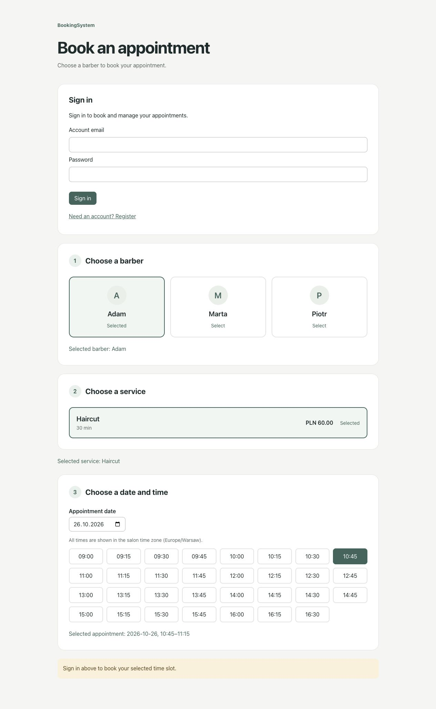
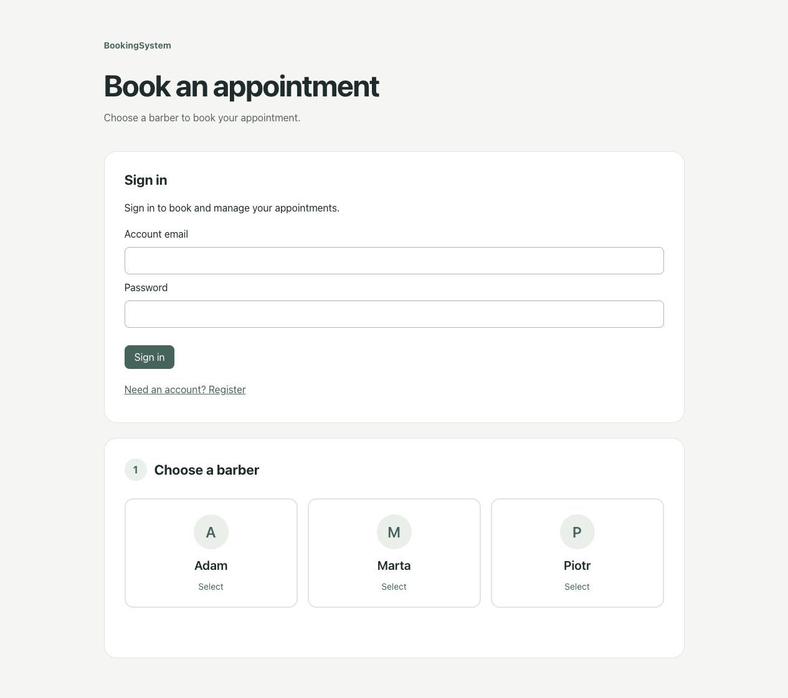

# BookingSystem

A service-booking portfolio project built with **ASP.NET Core 10, PostgreSQL,
React and TypeScript**. Customers select a barber, service, date and available
slot, then book and manage their own appointments.

The project focuses on backend rules, concurrency, authentication and automated tests.

## Features

- Provider-specific services, pricing and durations.
- Weekly working hours and 15-minute start intervals.
- Warsaw local-time display with UTC booking storage.
- Registration/login/logout using ASP.NET Core Identity and HttpOnly cookies.
- CSRF validation and owner-only booking history/cancellation.
- Database-enforced conflict prevention for concurrent bookings.
- Per-account idempotency keys and safe retry of uncertain submissions.
- Booking prices copied from the server-side catalogue and preserved independently of future price changes.
- Loading, empty, error and conflict states in the React client.
- Administrator panel for providers, services, weekly schedules and daily bookings.

## Prerequisites

- .NET 10 SDK (the installed 10.0 feature band is selected by `global.json`).
- Node.js 24 LTS and npm.
- Your own PostgreSQL database with permission to install `btree_gist`.
  A Neon project works; Docker is not required locally.
- Python 3.9+ only for optional API integration checks.

## Run locally

Use a separate development database. Never paste real database passwords into
source files, commits or GitHub issues.

### 1. Restore the backend and configure the database

From the repository root:

```sh
dotnet restore BookingSystem.slnx
cd backend
dotnet tool restore
dotnet user-secrets set "ConnectionStrings:BookingDatabase" "Host=YOUR_HOST;Database=YOUR_DATABASE;Username=YOUR_USER;Password=YOUR_PASSWORD;SSL Mode=VerifyFull;Channel Binding=Require;"
dotnet ef database update -- --environment Development
```

Replace all placeholders with your own connection settings. The example is for
Neon; a local PostgreSQL server may need different TLS settings. User Secrets is
outside the repository but is not encrypted. An alternative is the environment
variable `ConnectionStrings__BookingDatabase`. Avoid putting credentials in shell
history on shared machines; Rider's User Secrets editor can edit the local file.

### 2. Add demo providers and schedules (optional)

Still in `backend`:

```sh
dotnet run -- --seed-demo
```

This Development-only command adds missing Adam/Marta providers, Haircut services
and weekday 09:00–17:00 schedules. It preserves existing records and creates no
accounts or default passwords. It requires the migrations to have been applied.
Do not run demo seeding against production data.

### 3. Start the API

```sh
dotnet run
```

The default HTTP launch profile listens on `http://localhost:5130`.
OpenAPI JSON is available at `/openapi/v1.json` in Development.

### 4. Start React in a second terminal

From the repository root:

```sh
cd frontend
npm ci
npm run dev
```

Open `http://localhost:5173` (or the exact URL Vite prints). Use the same hostname
consistently: `localhost` and `127.0.0.1` have separate browser cookie/storage scopes.
Vite proxies `/api` to port 5130; changing that port requires updating `vite.config.ts`.

Register your own account, log in, select a provider/service and choose a future
weekday. Submit a booking, inspect **My bookings**, then cancel it to free the slot.
The interface is in English, with prices in PLN and appointment times in Europe/Warsaw. `npm run preview` serves a build preview only;
it does not provide the development API proxy.

## Administrator access

Register an account in the application first. From `backend`, using the same
database configuration as the API, run:

```sh
dotnet run -- --grant-admin your-account@example.com
```

This command grants the role only to an existing account; it never creates a
default password or accepts a role from public registration. It is repeatable.
Sign out and sign in again to receive the new permissions. The Administrator
panel appears above the customer booking flow. It supports adding providers and
services, setting/removing weekly hours and viewing/cancelling daily appointments.
Dates and times use Europe/Warsaw. Changing hours affects future availability;
existing bookings remain in place and must be reviewed separately. The daily
list is capped at 500 entries and indicates truncation; filter by provider.

Role provisioning requires trusted access to the server and its database
configuration. There is no public role-management endpoint.

## Verification

From the repository root:

```sh
dotnet test BookingSystem.slnx
npm --prefix frontend run build
npm --prefix frontend run lint
```

The xUnit suite does not require PostgreSQL. It covers overlap variants,
adjacent visits, invalid intervals, time-zone offsets, availability boundaries,
15-minute steps, past dates, the booking horizon and DST edge cases.

With the development API running and demo data seeded:

```sh
BOOKING_TEST_API=http://localhost:5130/api python3 backend/tests/identity_integration.py
```

This integration check writes test accounts/bookings into the chosen database.
Successful runs cancel their appointments; test accounts and cancelled history
remain. Price-snapshot checks additionally require an explicitly configured disposable
database; see [integration checks](backend/tests/README.md).

[GitHub Actions](.github/workflows/ci.yml) defines backend tests, frontend build/lint,
and API integration checks against an isolated PostgreSQL service. Its hosted run
must be verified after the repository is pushed; local checks do not imply a green
GitHub run.

## Repository structure

```text
backend/                     ASP.NET Core API, models, EF migrations and Identity
frontend/                    React + TypeScript application
tests/BookingSystem.Tests/   xUnit business-rule tests
docs/                        Architecture, screenshots and interview notes
```

## Screenshots





## Design details and limitations

- [Architecture and trade-offs](docs/ARCHITECTURE.md)
- [Authentication and CSRF](backend/AUTHENTICATION.md)

This is a portfolio MVP, not a production-ready booking service. There is no email
verification, password recovery, payment flow or leave/break scheduling.
Management endpoints require an Administrator role. Role provisioning is a
server-side command and is not exposed publicly. Production would additionally need verified email flows, abuse
controls, hosting/TLS configuration, key management, monitoring and backups.

## Before publishing

Review `git status` and staged diffs. `.gitignore` excludes build artifacts,
node_modules, IDE files and common secret files. Do not publish User Secrets,
private connection strings, real customer information or database exports.
